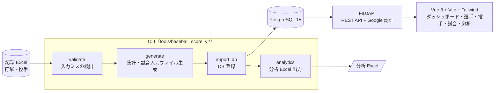
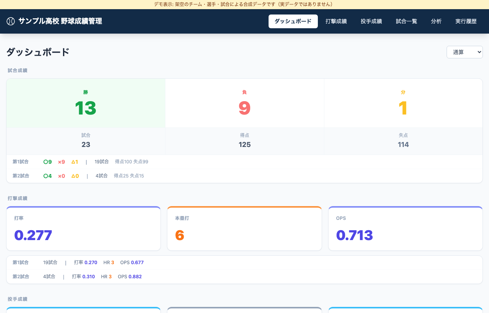
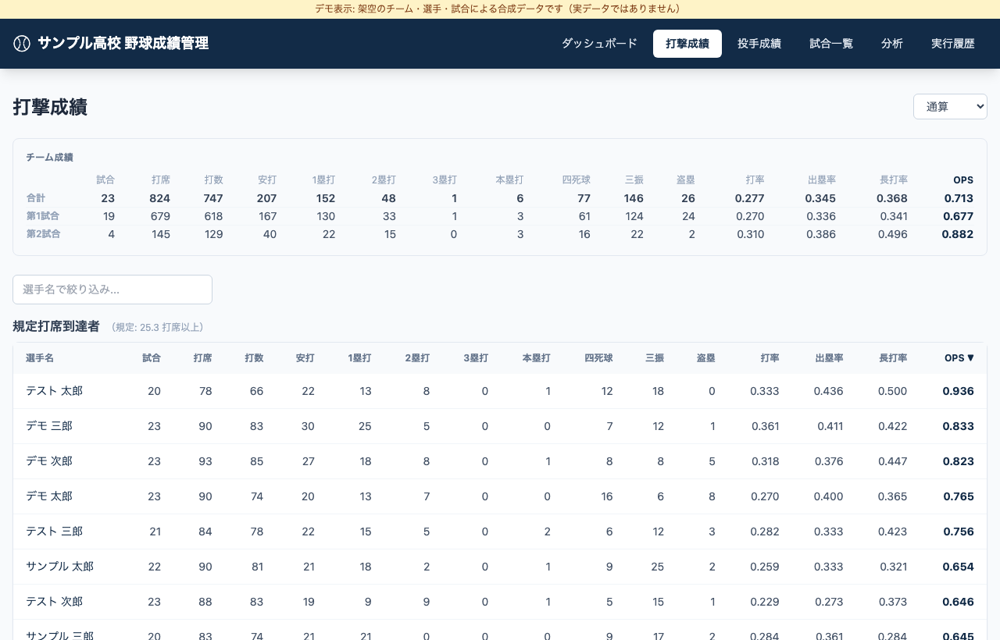
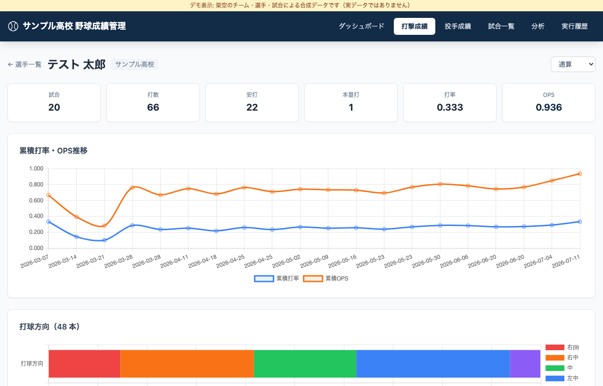
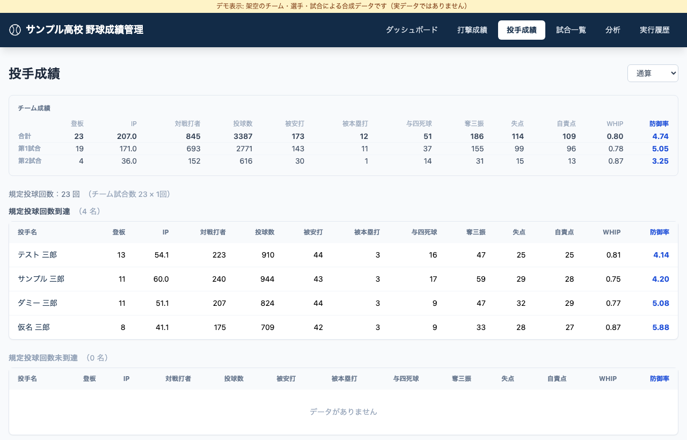

# baseball-stats-app — 野球チームの成績管理（Baseball Score v2）

高校野球チームの試合記録を、Excel から取り込んで DB に登録し、分析 Excel と Web 画面で見られるようにするツールです。個人開発（業務外）で、Python / FastAPI / Vue 3 / PostgreSQL / Docker / GitHub Actions を使っています。

[](https://github.com/yoshii04/baseball-stats-app/actions/workflows/deploy.yml)

> **このリポジトリの見どころ**: 3 本の個人開発リポジトリを並べた[紹介ページ](docs/portfolio/README.md)と、[設計判断と AI の使い方](docs/portfolio/design-decisions-and-ai.md)があります。

## 解決したいこと

- 試合ごとの打撃・投手の記録を Excel で管理しており、**入力ミスの検出・集計・シーズン通しての推移の確認**を手作業で行っていた
- Excel の記録を、**入力検証 → DB 登録 → 分析 Excel・Web 画面**の流れに移したい
- 成績を、チーム内のメンバーがログインしてブラウザで見られるようにしたい

## 仕組み



- 試合後の操作は `python run_all.py` の 1 コマンド（validate → generate → import_db → analytics）です。
- CLI は Controller → Service → Repository → Model の層構造で、Excel と DB の入出力は Repository に閉じています（[設計書](tools/baseball_score_v2/docs/design.md)）。
- Web 画面は DB の成績を読み取り専用で表示します。ログインは Google アカウントで、許可したメールアドレスだけが入れます（[ADR-0003](tools/baseball_score_v2/docs/adr/0003-google-oauth-allowed-emails.md)）。

## 画面

ダッシュボード（チーム成績）、選手一覧、選手詳細（累積推移・打球方向）、投手成績、試合一覧、分析、実行履歴の 7 画面です。一覧は[内側の README](tools/baseball_score_v2/README.md#画面構成)にあります。

次の画像は、架空のチーム・選手による合成データ（[デモ](tools/baseball_score_v2/demo/README.md)）の画面です。実データは写っていません。

| ダッシュボード | 打撃成績 |
|---|---|
|  |  |
| **選手詳細（累積推移・打球方向）** | **投手成績** |
|  |  |

## クイックスタート

実データ（成績の Excel）はリポジトリに含まれません。次の 2 通りで確かめられます。

### 0. 画面を見る（合成データ・Docker のみ）

```bash
cd tools/baseball_score_v2/demo
docker compose up --build   # → http://localhost:8090
```

架空のチーム「サンプル高校」の 23 試合分の成績で、全画面が動きます。Excel も Google アカウントも不要です。
認証を省略するローカル確認専用の構成です（詳細は [demo/README.md](tools/baseball_score_v2/demo/README.md)）。

### 1. テストを動かす（Docker・DB・実データは不要）

```bash
cd tools/baseball_score_v2
python -m venv venv && source venv/bin/activate
pip install -r requirements.txt -r webapp/backend/requirements.txt
DB_HOST=localhost DB_PORT=5432 DB_USER=test DB_PASSWORD=test DB_NAME=test \
  DB_SSLMODE=disable TEAM_NAME=test \
  python -m unittest discover -s tests -t . -p "test_*.py"
```

102 件のテストが通ります。CI（[deploy.yml](.github/workflows/deploy.yml) の `test` ジョブ）も同じコマンドです。

### 2. DB と API を起動する

```bash
cd tools/baseball_score_v2/docker
cp .env.example .env      # DB_PASSWORD などを書き換える
docker compose up -d      # PostgreSQL（初回は init.sql でテーブルを作成）と FastAPI
```

- API ドキュメント: http://localhost:8000/docs（`ENV=production` では無効）
- DB（ホスト側）: `127.0.0.1:5433`
- 認証付きの API を呼ぶには、`GOOGLE_CLIENT_ID` と `ALLOWED_EMAILS` の設定が必要です。

### 3. 画面を起動する

```bash
cd tools/baseball_score_v2/webapp/frontend
npm ci
npm run dev               # http://localhost:5173（/api は localhost:8000 へプロキシ）
```

`.env.local` に `VITE_GOOGLE_CLIENT_ID`（ログイン用）と `VITE_TEAM_NAME`（画面に出すチーム名）を設定します。

### 4. データを入れる

`tools/baseball_score_v2/config.json` に記録 Excel のパスを書き、`python run_all.py` を実行します（[運用手順](tools/baseball_score_v2/docs/operations.md)）。合成データで画面まで一気に確かめられる手順は、整備中です。

DB の初期化から画面の起動までを一括で行う `python dev_start.py` もあります。**既定では `docker compose down -v` で DB のデータを削除します**。データを残すときは `--skip-init-db` を付けます。

## 設計判断の記録（ADR）

| ADR | 内容 | ステータス |
|---|---|---|
| [0001](tools/baseball_score_v2/docs/adr/0001-vue3-spa-frontend.md) | フロントエンドに Vue 3（SPA）を採用する | 採用済み |
| [0002](tools/baseball_score_v2/docs/adr/0002-plain-sql-without-orm.md) | ORM を使わず psycopg2 で SQL を直接書く | 採用済み |
| [0003](tools/baseball_score_v2/docs/adr/0003-google-oauth-allowed-emails.md) | Google OAuth と許可メールリストで認証する | 採用済み |
| [0004](tools/baseball_score_v2/docs/adr/0004-defer-alembic-migrations.md) | DB マイグレーション（Alembic）の導入を見送る | 提案（要承認） |
| [0005](tools/baseball_score_v2/docs/adr/0005-stop-aws-public-hosting.md) | AWS 上の常時公開を止め、ローカル利用と必要時の起動にする | 採用済み（遡及記録） |

ADR-0001〜0003・0005 は実装後に遡って書いた記録で、当時の動機が残っていない箇所は「記録なし」と明記しています。

## ドキュメント

| 文書 | 内容 |
|---|---|
| [内側の README](tools/baseball_score_v2/README.md) | 機能、設定、ファイル形式、処理フロー、API・画面の詳細、トラブルシューティング |
| [設計書](tools/baseball_score_v2/docs/design.md) | 層構造、各ファイルの役割、DB スキーマ |
| [運用手順](tools/baseball_score_v2/docs/operations.md) | 試合後の操作（`run_all.py` ほか CLI の使い方） |
| [スコア写真の CSV 化](tools/baseball_score_v2/docs/score-photo-to-csv.md) | スコアブックの写真をスコア CSV にする手順 |
| [AWS 手順](tools/baseball_score_v2/docs/aws-deploy.md) | EC2 の起動 → データ登録 → 停止 |
| [CLAUDE.md](tools/baseball_score_v2/CLAUDE.md) | 構成・規約・注意点（開発者・AI 向け） |

## CI と運用

- **テスト**: `main` への push と PR で自動実行します。
- **デプロイ**: AWS（EC2 + Nginx + S3 + CloudFront）への手動デプロイを、GitHub Actions の `workflow_dispatch` で用意しています。学習目的で構築しましたが、**費用の関係で現在は停止中**です（2026-10-12 時点）。判断の経緯は [ADR-0005](tools/baseball_score_v2/docs/adr/0005-stop-aws-public-hosting.md)、再開手順は [AWS 手順](tools/baseball_score_v2/docs/aws-deploy.md)にあります。
- **ブランチ名**: `<種別>/<機能名>`（例: `docs/a4-readme-entry`）。規則は [CLAUDE.md](tools/baseball_score_v2/CLAUDE.md) にあります。

## リポジトリの構成

```
baseball-stats-app/
├── README.md                      # 本ファイル
├── docs/portfolio/                # 3 リポジトリの紹介、設計判断と AI の使い方
├── docs/images/                   # README 用のスクリーンショット（合成データ）
├── .github/workflows/deploy.yml   # テスト（自動）・EC2 デプロイ（手動）
├── docker/                        # 旧構成（PostgreSQL のみ）。現行は tools/baseball_score_v2/docker/
└── tools/baseball_score_v2/       # アプリ本体（CLI・Web API・Web 画面・テスト・docs）
    └── demo/                      # 合成データのデモ（docker compose で画面まで起動）
```

## ライセンス

ポートフォリオとしての**閲覧のみ**を目的に公開しています。GitHub 上での閲覧と fork を除き、利用・複製・改変・再配布は許諾していません（[LICENSE](LICENSE)）。
